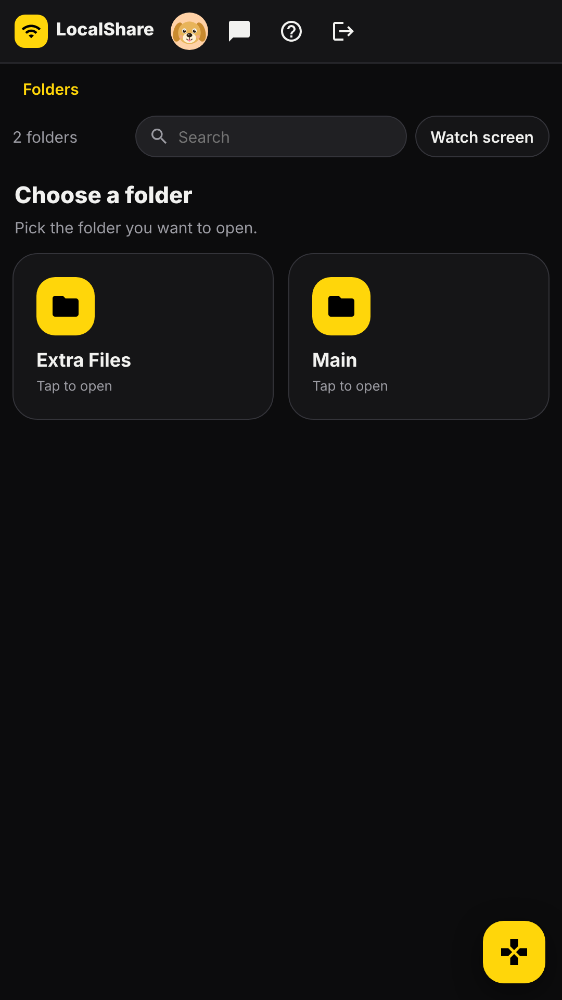
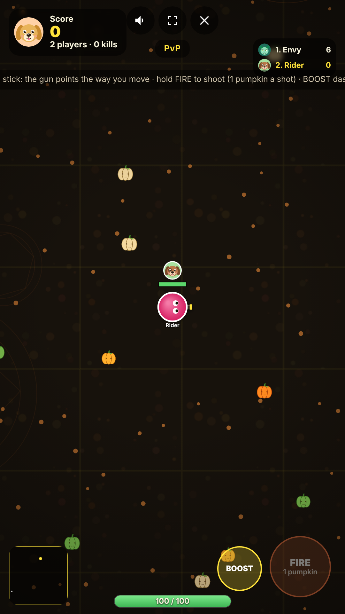
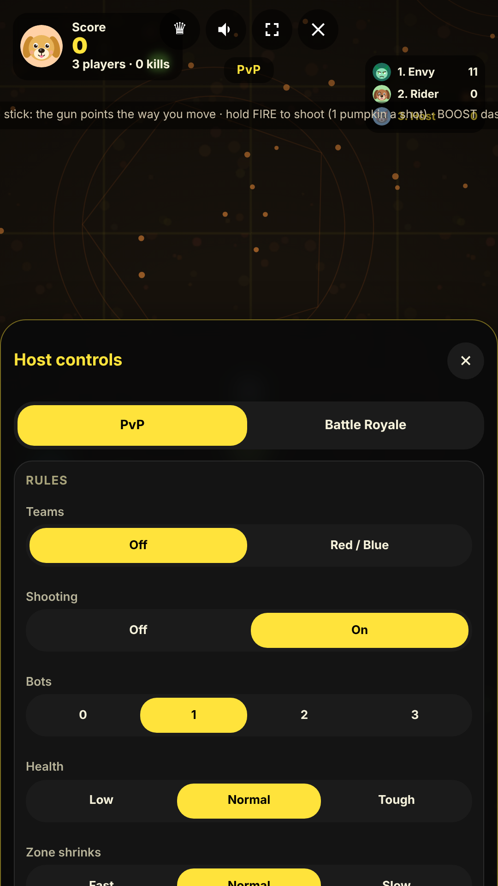

# LocalShare

<p align="center">
  
</p>
[Watch the video to get an explanation (https://img.youtube.com/vi/VIDEO_ID/0.jpg)](https://youtu.be/pKN4d6VoIXg?si=pPMbGjQJum6_s8oe)


<h3 align="center">Turn your Android phone into a local sharing platform.</h3>

<p align="center">
  Share files, stream your screen, play media, chat, connect to TV, and play multiplayer games — all over your local Wi-Fi or hotspot.
</p>

---

## Screenshots

<p align="center">
  
  
  
</p>


---

## Features

### 📁 File Sharing
Share multiple folders from your Android phone through a browser. Users can browse, upload, download, rename, move and delete files and folders.

### 🎬 Media & Documents
Built-in viewers for **videos, music, images, PDFs, documents and code**, including advanced controls such as playlists, zoom, search, printing and editing.

### 🔐 Access Control
Use passwords, device approval, session limits and per-device permissions to control who can access your shared content.

### 📱 Phone-to-Phone
Discover nearby LocalShare devices, join using QR codes, and send files directly between phones.

### 🖥️ Live Screen Sharing
Stream your Android screen over the local network with hardware H.264 encoding, quality controls, audio support and live status information.

### 💬 Local Chat
Chat with connected users using messages, images, reactions, moderation tools and unread notifications.

### 🎮 Multiplayer Arcade
Play local browser-based games including **Tic-Tac-Toe, Connect 4, Pong, Snake Battle and Draw & Guess**.

### 🔮 Orb Arena
A full multiplayer combat game with PvP, Battle Royale, bots, weapons, health, powers, minimap, leaderboard, touch controls and spectator mode.

### 🐜 Insect System
Orb Arena includes an evolving insect food-chain system with different species, attack patterns, powers and boss insects.

### 📺 LocalShare TV
Connect to LocalShare TV using a code and send media from your phone to a TV without using USB storage.

### 🎨 Customization
Customize accent colours, home icons, profiles, avatars and Orb Arena appearance.

### 🔒 Background Hosting
The server can continue sharing while the phone screen is locked using Android foreground and Wi-Fi/wake services.

### 🌐 Local Network
Works over Wi-Fi or hotspot without requiring cloud storage or internet access for local sharing.

---

## 🛠️ Built With

- Kotlin
- Jetpack Compose
- Material 3
- Pure Java HTTP/WebSocket server
- Android API 21+
- Local Web Interface

## 🚀 Build

```bash
./gradlew assembleDebug
```

Debug APK:

```text
app/build/outputs/apk/debug/app-debug.apk
```

## 🧩 Architecture

```text
Android Phone
     │
     ├── Kotlin + Jetpack Compose
     │
     ├── Local HTTP/WebSocket Server
     │
     └── Browser Interface
          ├── File Manager
          ├── Media Players
          ├── PDF / Document Viewer
          ├── Code Editor
          ├── Chat
          └── Multiplayer Games
```

## 📜 Project

LocalShare evolved from a simple local file-sharing app into a complete **local media, communication, streaming, TV and multiplayer platform**.

**Author:** DEMON_GOD
**comment:** i will be shifting the while projrct to rust soon 
**License:** See `LICENSE`.
